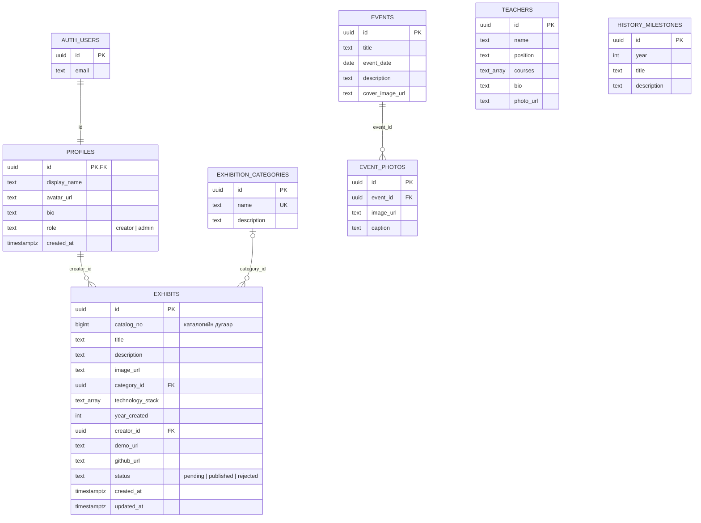

# Өгөгдлийн сангийн схем (ERD)

## Холбоосын тайлбар

| Foreign key | Холбоо | Зориулалт | Устгах үед |
| --- | --- | --- | --- |
| `profiles.id` → `auth.users.id` | 1:1 | Нэвтрэлтийн бүртгэлийг нийтийн профайлтай холбоно. Нэг багана PK ба FK хоёулаа. | Профайл устана |
| `exhibits.creator_id` → `profiles.id` | 1:N | Нэг бүтээгч олон бүтээлтэй. RLS эзэмшлийг энэ баганаар шалгана. | Бүтээл устана |
| `exhibits.category_id` → `exhibition_categories.id` | N:1 | Ангиллаар шүүх. Заавал биш. | `NULL` болно, бүтээл үлдэнэ |
| `event_photos.event_id` → `events.id` | 1:N | Арга хэмжээний зурагт цомог. | Зураг устана |

**Primary key:** хүснэгт бүрийн `id` нь мөрийг давтагдашгүй тодорхойлно. Дарааллын тоо бус UUID ашигласнаар бичлэгийн тоог таахаас хамгаална.

## Жишиг бүтцээс өөрчилсөн зүйл

- `exhibits.category` → `category_id` FK болгов: ангиллын нэр солигдоход бүх бүтээлийг шинэчлэх шаардлагагүй.
- `profiles.role`, `profiles.bio`: админ эрх болон ISM Creators-ийн танилцуулгад нэмэв.
- `exhibits.catalog_no`: музейн каталогийн дугаар (`ISM.2024.007`) харуулна.
- `history_milestones`: тэнхимийн түүх, Time Machine-д зориулж нэмэв.

## RLS товч

| Хүснэгт | Унших | Бичих |
| --- | --- | --- |
| `profiles` | Бүгд | Зөвхөн өөрийн `display_name`, `avatar_url`, `bio` |
| `exhibits` | `published` бол бүгд; бусдыг нь эзэмшигч, админ | Эзэмшигч эсвэл админ |
| `teachers`, `events`, `event_photos`, `history_milestones`, `exhibition_categories` | Бүгд | Зөвхөн админ |
| `storage.objects` (`media`) | Бүгд | Өөрийн `<user id>/` хавтас; устгах, солихыг админ бас хийнэ |
